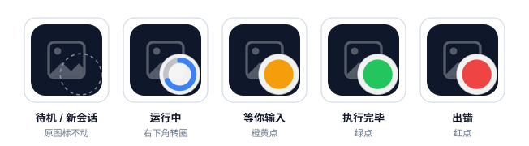
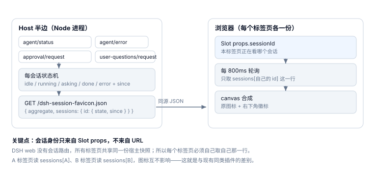
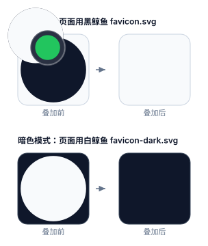

# dsh-session-favicon

> 让 DSH web 的**标签页图标**显示**这个标签页自己的会话状态**：运行中转圈、完成绿点、等你输入橙黄点、出错红点；新建/刚进入的会话一律不动原图标。
>
> 多开标签页时，每个标签页各看各的会话——互不同步。

<a href="docs/states.svg"></a>

<p align="center"><sub>示意图：徽标按 <code>client.js</code> 里的真实常量绘制（中心 70%、半径 24%、1.20 倍底板），底图用一个中性圆盘代表"页面自己的图标"。</sub></p>

---

## English summary

A DSH web plugin that paints **this tab's** session state onto the browser tab icon: a spinner while the agent runs, a green dot when the turn completes, an amber dot while it waits for you (approval / plan review / `ask_user_question`), a red dot after an error — and the original icon untouched for an idle, new, or re-entered session.

Unlike the existing favicon plugins, which aggregate the whole workspace (so every tab shows the same icon), this one resolves the tab's own Session through the Slot system (`SessionStandardProps.sessionId`) and reads only that Session's row.

## 和现有插件的差别

| 插件 | 状态来源 | 多标签页语义 | 错误态 |
|---|---|---|---|
| [dsh-web-icon-indicator](https://github.com/waknow/dsh-web-icon-indicator) | 宿主 `agent/*` 事件 | ❌ 全局聚合 + 活动数 | 无 |
| [dsh-favicon-status](https://github.com/bf185003/dsh-favicon-status) | 客户端 `uiSession.sessionStatus` | ❌ 全局聚合（环形占比） | 无 |
| [WsTe47/dsh-tab-status](https://github.com/WsTe47/dsh-tab-status) | 会话进度 | ❌ 全局计数徽章 | 无 |
| **dsh-session-favicon**（本插件） | 宿主 per-session 状态机 + Slot 会话身份 | ✅ **每个标签页只看自己的会话** | ✅ 红点 |

## 五种状态

| 状态 | 图标（右下角 3/5 区域） | 触发条件 |
|---|---|---|
| `idle` | **原图标，一个像素都不改** | 没有会话绑定；或该会话没有任何事件 |
| `running` | 蓝色转圈（12 帧预渲染，约 1 圈/秒） | `agent/status` → `running` |
| `asking` | 橙黄点 `#f59e0b` | `approval/request` 或 `user-questions/request` 处于 pending 窗口（权限确认、计划评审、提问都走这里） |
| `done` | 绿点 `#22c55e` | 该轮结束且本轮没有错误 |
| `error` | 红点 `#ef4444` | `agent/error`、`api-session/error`，或本轮以 error 收敛 |

补充两点语义：

- **`done` / `error` 是"通知"，不是持久事实**：只有发生在**本次页面打开之后**的状态才会显示（`since > loadedAt`）。所以刷新进一个早就跑完的会话，图标保持原样。宿主侧另有 30 分钟衰减（`SETTLED_TTL_MS`），避免一个旧绿点长期掩盖新会话。
- **优先级**：`asking > error > running > done > idle`。这条规则只用于响应里给调试用的 `aggregate` 字段，客户端不再使用它——正是"读 aggregate"导致的多标签同步问题。

## 它是怎么工作的

<a href="docs/flow.svg"></a>

**Host 半边**（`index.js`）订阅宿主事件维护 `Map<SessionId, 状态>`，用一个同源 JSON 路由把快照吐出去：

```
GET /dsh-session-favicon.json
{
  "v": 1,
  "now": 1794390932256,
  "aggregate": "running",              // 调试用，客户端不读
  "aggregateSince": 1794390479976,
  "sessions": {
    "session-…a": { "state": "done",    "since": 1794390489215 },
    "session-…b": { "state": "running", "since": 1794390479976 }
  }
}
```

**Client 半边**（`client.js`）做四件事：

1. 在 `conversation.composer.dock`（`scope: 'session'` 的 list 座席）挂一个**渲染 `null`** 的组件，从 props 读 `sessionId`——这就是"本标签页是哪个会话"。身份只来自 Slot，不来自 URL（DSH web 没有会话路由）。
2. 每 800ms 轮询上面的路由，**只取 `sessions[sessionId]` 那一行**。没有会话绑定时不轮询、不画。
3. 把页面原本的 favicon 抓进 canvas，在右下角画徽标，写出 `data:image/png`。
4. 切换会话时先回落原图标再读新行，避免把上一个会话的绿点带过去。

会话身份的内核链路（`@deepseek-ai/dsh-client-ui-session`）：

```
uiSession BUILTIN_SOURCE  props: ["sessionId"], resolve: (b) => ({ props: { sessionId: b.sessionId } })
renderer standardKit      { ...root 标准属性, ...session 标准属性 }
StrictSessionEntry → SessionEntry → renderEntry(Comp, standard, …)
```

## 明暗模式

<a href="docs/themes.svg"></a>

DSH 页面自带**两套** favicon，靠媒体查询切换：`favicon-dark.svg`（白色鲸鱼，`prefers-color-scheme: dark`）与 `favicon.svg`（黑色鲸鱼，`light`）。本插件的处理：

- 抓取时记录每个 `link` 的 `media`，**合成时保留 `media` 不删**，两套各自用各自的底图合成 → 浏览器仍然按明暗自动挑。
- 徽标在鲸鱼身上会被吞色，所以加了一层**同色系底板 + 描边**：亮色用白底（`rgba(255,255,255,.94)` + 深描边），暗色用深底（`rgba(15,23,42,.88)` + 浅描边）。白鲸鱼身上、暗色标签栏里都读得出来。
- 明暗切换**不需要监听**：两套合成图在初始化时都已缓存，系统切换时浏览器直接换 `link`。
- 跟随的是**操作系统的 `prefers-color-scheme`**，不是应用内主题——因为浏览器标签栏的颜色跟的是操作系统/浏览器主题，宿主自己的 favicon 也是这么做的。

## 安装

```sh
# 方式一：命令行
dsh plugin --profile web add /path/to/dsh-session-favicon

# 方式二：让 Agent 用 plugin_manager 安装（install_bundle，target 传包目录绝对路径）
```

**新增 bundle 要重启一次 `dsh web`** 才会进入 profile 装配；装好之后再改 `client.js` 可以热更（宿主每 500ms 轮询插件产物并推给页面），而改 `index.js`（宿主半边）需要重启——进程内 ESM 缓存不会重新加载。

## 自检

浏览器控制台：

```js
window.__DSH_SESSION_FAVICON__
// {
//   sessionId: "session-…",                 // null = 没拿到会话身份（座席没挂上）
//   state: "running",                       // 当前画的状态
//   schemes: ["dark", "light"],             // 抓到的 favicon 变体
//   preferredScheme: "dark",                // 系统当前偏好
//   updatedAt: 1794390932256
// }
```

宿主路由也能直接看：

```sh
curl -s http://127.0.0.1:3080/dsh-session-favicon.json
```

## 可调参数

| 常量 | 文件 | 说明 |
|---|---|---|
| `STATUS_PATH` | 两边必须一致 | 宿主路由路径，默认 `/dsh-session-favicon.json` |
| `POLL_MS` | `client.js` | 轮询间隔，默认 800ms |
| `FRAMES` / `FRAME_MS` | `client.js` | 转圈帧数（12）与帧间隔（≈83ms；帧相位按墙钟计算，后台标签被节流也继续前进） |
| `CX` / `CY` / `R` | `client.js` | 徽标中心与半径（占图标边长的比例），默认 `0.70 / 0.70 / 0.24` |
| `PLATES` | `client.js` | 明暗两套底板与描边颜色 |
| `DOT_COLORS` | `client.js` | 绿 / 橙黄 / 红 |
| `SETTLED_TTL_MS` | `index.js` | `done` / `error` 在宿主侧的保留时长，默认 30 分钟 |

改颜色只改常量即可；`idle` 永远不画，所以不存在"恢复不回去"的问题——清理时会把 `href` 与 `media` 原样写回。

## 已知边界

- **依赖较新内核**：会话身份来自 Session 域 Slot props 的 `sessionId`（`@deepseek-ai/dsh-client-ui-session` 的 built-in source）。开发与验证都在 **DSH `0.2.2-alpha.3`** 上；更老的宿主上插件会安静地不画（`sessionId` 为 `undefined`），不会破坏页面。
- **800ms 轮询**：状态最多延迟约 0.8 秒。没有做 SSE——状态跳变不频繁，轮询实现更小、更好审。切回前台会立刻补拉一次。
- **不是"跨标签页的待办清单"**：只显示当前标签页的会话。想知道"别的标签页有没有事"，需要另一个聚合视图（这恰好是现有三个插件的做法）。
- **`composer.dock` 座席**：会话级 list 座席在会话打开期间常驻；如果某些视图把它收起，图标会短暂回到 `idle`。可用 `__DSH_SESSION_FAVICON__.sessionId` 判断。

## 验证情况

- 宿主半边：`/dsh-session-favicon.json` 实测可用；用真实子 agent 会话验证过 `running → done` 的跃迁、多会话混合状态、优先级聚合与衰减。
- 客户端半边：`node --check` 通过；插件已进入启动图（`/plugins/events` 的 SSE 可见 `immediately: true` 与产物 rev），宿主对外的字节与仓库源码一致。
- **未验证**：真实标签页里的视觉呈现（本机浏览器控制通道无法挂载 DSH GUI 页签名）。README 里的三张图是按代码常量绘制的**示意图**，不是运行截图。

## 目录结构

```
dsh-session-favicon/
├── package.json          # dsh.bundle.patch + dsh.client(platform=web, immediately)
├── cordis.patch.yml      # 插入一行宿主插件：session-favicon
├── index.js              # 宿主半边：事件 → 状态机 → JSON 路由
├── client.js             # 客户端半边：Slot 会话身份 + canvas 合成 + 轮询
├── icon.svg              # 插件管理器里的行图标（中间调，明暗主题都看得见）
├── locale/{en,zh}.json   # meta.title / meta.description
└── docs/
    ├── generate-figures.mjs  # 生成下面三张图（徽标常量镜像自 client.js）
    └── *.svg                 # README 示意图
```

无构建步骤：`client.js` 直接就是 `window.__ModuleLoader__.load({ id, factory })` 工厂，`index.js` 是普通 ESM 插件。

## 开发

```sh
node --check index.js && node --check client.js   # 语法
curl -s http://127.0.0.1:3080/dsh-session-favicon.json   # 看宿主状态快照
node docs/generate-figures.mjs                    # 重新生成 README 里的三张图
```

`docs/generate-figures.mjs` 把徽标几何与配色从 [`client.js`](client.js) 镜像了一份（`CX / CY / R / PLATE_SCALE / DOT_SCALE / ARC_SCALE / DOT_COLORS / PLATES`），
所以改了这些常量请顺手重跑一次，图就不会和实现脱节。脚本自带两道断言：每个图标的 `translate` 必须与所在格子对齐，所有图元不得越出画布。

改完 `client.js` 等约 1 秒，宿主会把新产物推给已打开的页面；核对仓库源码与宿主实际下发字节是否一致，可用 `/plugins/events` 的 SSE 拿到 `rev`，再取 `plugins/??dsh-session-favicon/client.js&rev=<rev>`。

## License

MIT，见 [LICENSE](LICENSE)。
